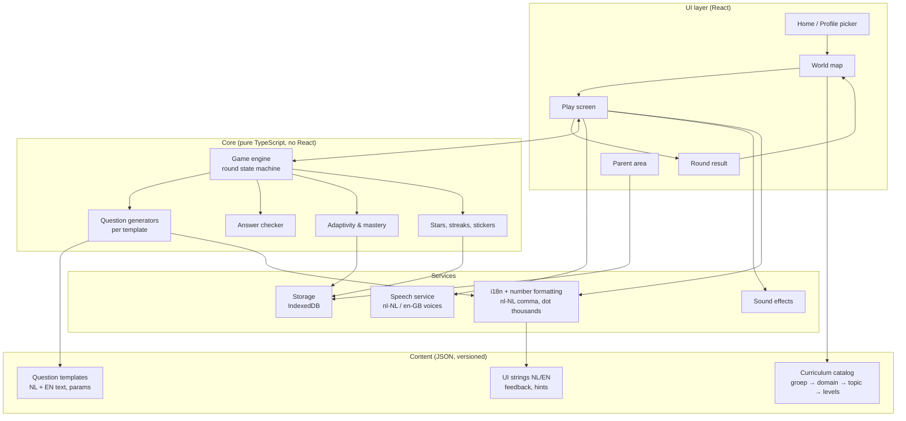
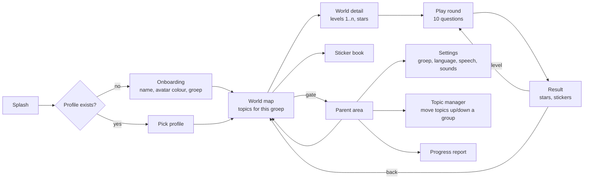
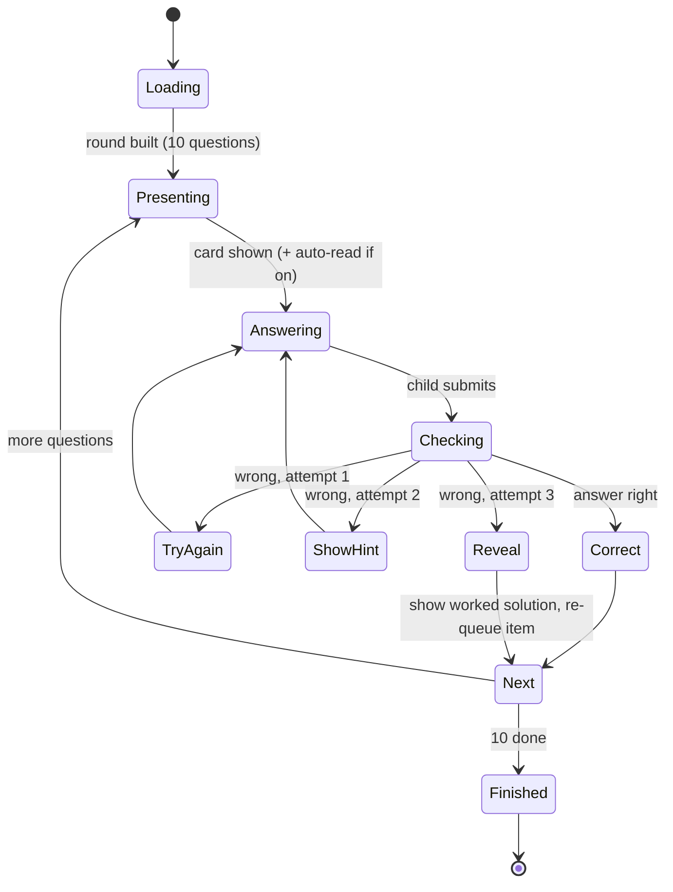
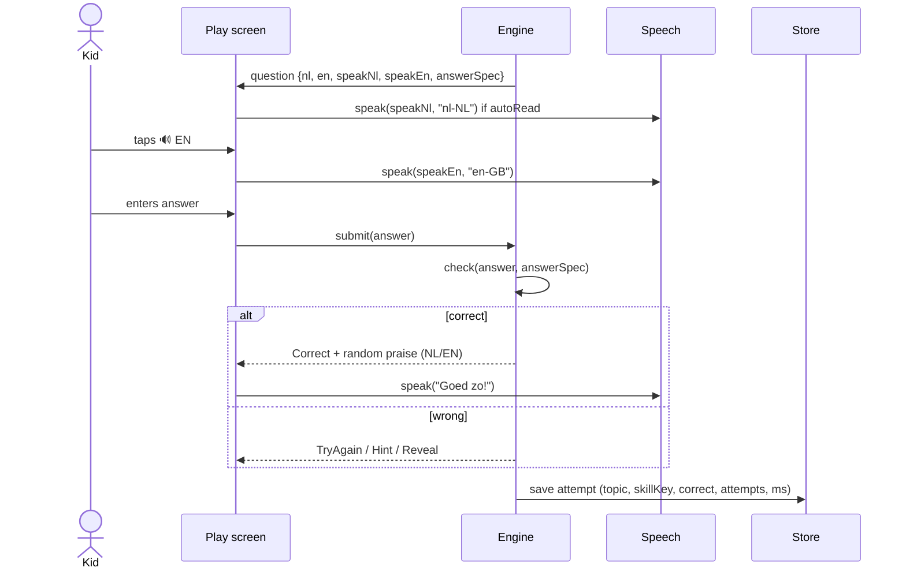
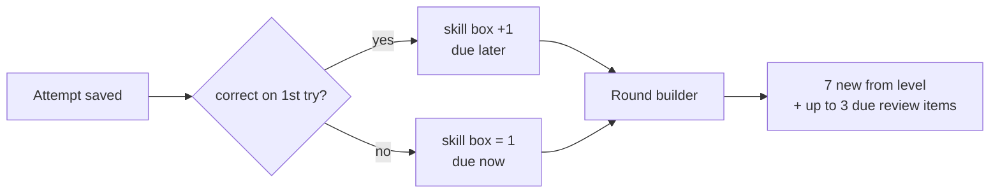
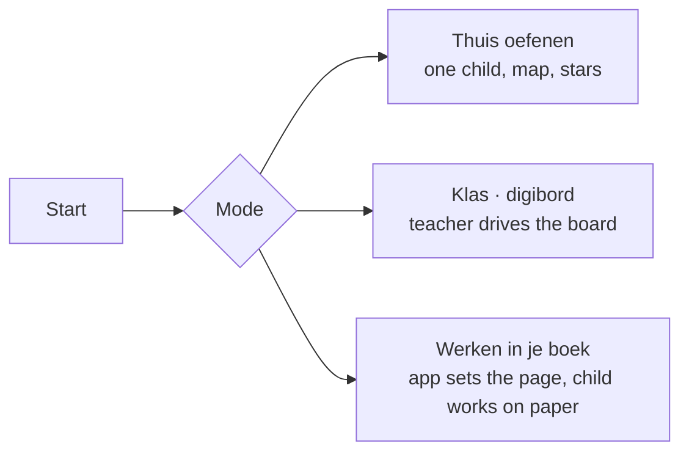
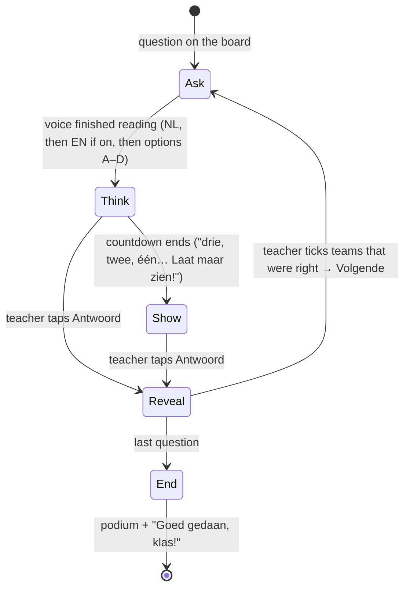
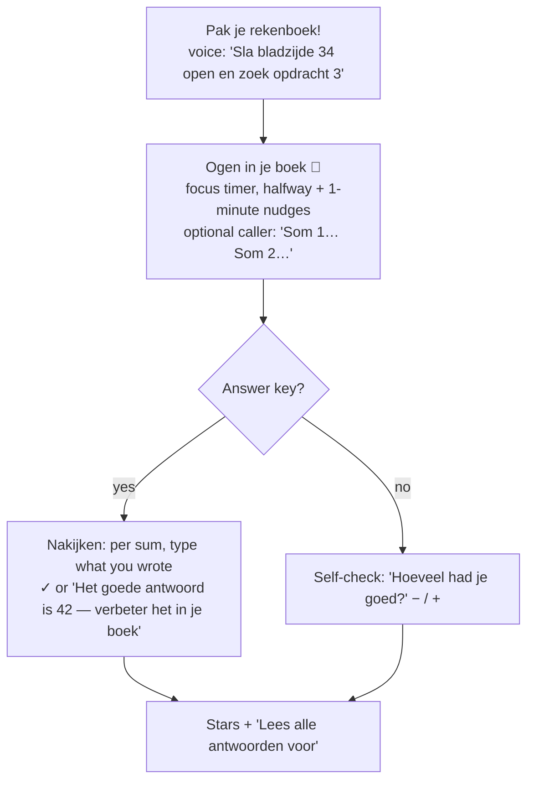

# Rekenpret — System Flow Design (build spec for Claude Code)

> Playful maths practice for one child at home, following the Dutch primary-school progression (groep 1–8). Every question is in Dutch with an English translation, and both can be read aloud.
>
> **How to use this file:** put it in the root of a new repo as `docs/SPEC.md`, copy section 14 into `CLAUDE.md`, then build milestone by milestone (section 13). The visual rules come from the *Rekenpret* design system; the tokens are copied in section 11 so the build doesn't depend on it.

---

## 1. Goals and non-goals

**Goals**

- Short, fun rounds (10 questions, 3–5 minutes) that feel like a game, not a test.
- Content matches the Dutch *kerndoelen rekenen-wiskunde* by group, across four domains: **Getallen**, **Verhoudingen**, **Meten & Meetkunde**, **Verbanden**.
- Dutch first. English translation always available (shown, on tap, or hidden).
- Read-aloud in Dutch (`nl-NL`) and English (`en-GB`) for every question, hint and feedback message.
- Works offline on a tablet or laptop. No account, no backend, no ads, no tracking.
- A parent area (behind a simple gate) for choosing the group, adjusting topics and seeing progress.

**Non-goals (v1)**

- No classroom/teacher features, multiplayer or cloud sync.
- No runtime machine translation. All Dutch and English text is written ahead of time in templates, so it is always correct maths language (see §7).
- No free-text answers that need AI checking. All answers can be checked by the app itself.

---

## 2. Tech stack (defaults)

| Concern | Choice | Why |
| --- | --- | --- |
| App | **React 18 + TypeScript + Vite** | Fast, well known to Claude Code |
| Offline / install | **PWA** (`vite-plugin-pwa`) | Installs on iPad/Android/desktop, works offline |
| Styling | CSS Modules + `tokens.css` (§11) | Tokens map directly from the design system |
| State | **Zustand** | Small, simple game state |
| Storage | **IndexedDB** via `idb-keyval` (with localStorage fallback) | Profiles and progress stay on the device |
| Speech | **Web Speech API** `speechSynthesis` | Built in, offline voices on most devices |
| Drag & drop | `@dnd-kit/core` | Touch-friendly |
| Animation | CSS + `framer-motion` (only for the celebration) | Respects reduce-motion |
| Sound effects | `howler` or plain `<audio>` | Chime on correct |
| Tests | **Vitest** (generators, engine) + **Playwright** (flows) | |
| Lint/format | ESLint + Prettier | |

Optional later: a Capacitor wrapper for app stores, and Supabase for syncing between devices.

---

## 3. Architecture



**Rule:** everything in `core/` is pure TypeScript with no React or browser APIs, so it can be unit-tested and generated content can be checked automatically.

---

## 4. Screen map and navigation



| Screen | Purpose | Key elements |
| --- | --- | --- |
| Onboarding | First run | Name, pick a colour, choose groep (parent helps), test voices |
| World map | Choose what to play | One "world" per topic; locked/unlocked; stars per world; "Daily mix" button |
| World detail | Pick a level | Level tiles 1–n with 0–3 stars; replay any unlocked level |
| Play | The question loop | Question card, NL line + EN line, 🔊 NL / 🔊 EN buttons, answer input, hint button, progress bar |
| Result | Celebrate | Stars earned, streak, new sticker, "Nog een keer" / "Volgende" |
| Parent area | Control | Groep, EN display mode, speech rate, sounds, topic mapping, progress per topic |

**Parent gate:** a simple grown-up check (e.g. "Hold the button for 3 seconds" + "Type 7 × 8"), not a password. Optional 4-digit PIN in settings.

---

## 5. The question loop

### 5.1 Round state machine



### 5.2 One question, step by step



### 5.3 Scoring and stars

- Points per question: correct on 1st try = 3, 2nd try = 2, after the hint = 1, revealed = 0.
- Stars per level: ≥ 26 points ⭐⭐⭐, ≥ 20 ⭐⭐, ≥ 14 ⭐ (out of 30). One star unlocks the next level.
- Speed never costs points (no timers by default). An optional "Race mode" for times tables can be switched on in the parent area.

---

## 6. Data model (TypeScript)

```ts
// content/types.ts
export type Groep = 1 | 2 | 3 | 4 | 5 | 6 | 7 | 8;
export type Domain = 'getallen' | 'verhoudingen' | 'meten-meetkunde' | 'verbanden';
export type Lang = 'nl' | 'en';

export interface Topic {
  id: string;                 // 'g4-tafels-2-5-10'
  groep: Groep;               // default group; parent can override
  domain: Domain;
  title: Record<Lang, string>;// { nl: 'Tafels van 2, 5 en 10', en: 'Tables of 2, 5 and 10' }
  levels: Level[];
}

export interface Level {
  id: string;                 // 'g4-tafels-2-5-10/L1'
  templateIds: string[];      // which generators to mix
  params: Record<string, unknown>; // e.g. { tables: [2], max: 10 }
  questionCount: number;      // default 10
}

export type QuestionKind =
  | 'choice'      // tap one of 3–4 tiles
  | 'numpad'      // type a number
  | 'numberline'  // drag a marker to a value
  | 'clock'       // set or read an analog clock
  | 'money'       // drag coins/notes to a total
  | 'fraction'    // shade parts of a pizza/bar
  | 'match'       // drag pairs together
  | 'compare';    // <, =, >

export interface QuestionTemplate {
  id: string;                 // 'add-within'
  kind: QuestionKind;
  skillKey: (p: GenParams) => string;     // '7+8' — used for spaced repetition
  generate: (p: GenParams, rng: Rng) => Question;
}

export interface Question {
  id: string;
  templateId: string;
  kind: QuestionKind;
  skillKey: string;
  text: Record<Lang, string>;    // shown text
  speak: Record<Lang, string>;   // text for the voice (may differ, see §8)
  hint: Record<Lang, string>;
  solution: Record<Lang, string>;// worked solution shown on Reveal
  visual?: VisualSpec;           // apples, rekenrek beads, clock face…
  answer: AnswerSpec;
}

export type AnswerSpec =
  | { type: 'number'; value: number; decimals?: number }
  | { type: 'choice'; options: string[]; correctIndex: number }
  | { type: 'time'; h: number; m: number }
  | { type: 'fraction'; num: number; den: number; acceptEquivalent: boolean }
  | { type: 'pairs'; pairs: [string, string][] }
  | { type: 'compare'; value: '<' | '=' | '>' };

export interface Profile {
  id: string;
  name: string;
  colour: 'brand' | 'accent' | 'sun' | 'correct';
  groep: Groep;
  createdAt: string;
}

export interface Settings {
  englishMode: 'always' | 'onTap' | 'hidden'; // default 'onTap'
  autoReadNl: boolean;                         // default true for groep 1–4
  speechRate: number;                          // default 0.9
  sounds: boolean;
  raceMode: boolean;
  topicOverrides: Record<string, Groep>;       // parent moves topics between groups
  parentPin?: string;
}

export interface Attempt {
  profileId: string;
  topicId: string;
  levelId: string;
  skillKey: string;
  correct: boolean;
  tries: number;        // 1..3, or 4 = revealed
  ms: number;
  at: string;
}

export interface LevelProgress { levelId: string; bestStars: 0 | 1 | 2 | 3; plays: number; }
export interface SkillStat { skillKey: string; box: 1 | 2 | 3 | 4 | 5; due: string; } // Leitner boxes
```

**Storage keys (IndexedDB):** `profiles`, `settings:<profileId>`, `progress:<profileId>`, `skills:<profileId>`, `attempts:<profileId>` (keep the last 2,000), `stickers:<profileId>`.

---

## 7. Content: curriculum catalog and templates

### 7.1 Catalog (`content/curriculum.json`)

A typical progression. The parent can move topics to match the school's method (Pluspunt, Wereld in Getallen, Getal & Ruimte Junior…).

| Groep | Topic ids (examples) |
| --- | --- |
| 1–2 | `g1-tellen-tot-20`, `g1-meer-minder`, `g1-vormen`, `g1-patronen` |
| 3 | `g3-splitsen-tot-10`, `g3-plus-min-tot-10`, `g3-plus-min-tot-20`, `g3-klok-hele-halve`, `g3-geld-tot-20` |
| 4 | `g4-getallen-tot-100`, `g4-plus-min-tot-100`, `g4-tafels-1-2-5-10`, `g4-klok-kwartier`, `g4-meten-cm-m`, `g4-geld-tot-100` |
| 5 | `g5-getallen-tot-1000`, `g5-alle-tafels`, `g5-deeltafels`, `g5-klok-minuten-digitaal`, `g5-breuken-intro`, `g5-gewicht-inhoud` |
| 6 | `g6-cijferend-plus-min`, `g6-vermenigvuldigen`, `g6-breuken`, `g6-kommagetallen`, `g6-omtrek`, `g6-grafieken` |
| 7 | `g7-staartdeling`, `g7-procenten`, `g7-breuken-rekenen`, `g7-verhoudingstabel`, `g7-oppervlakte`, `g7-24-uurs-klok` |
| 8 | `g8-gemengd`, `g8-procenten`, `g8-schaal`, `g8-inhoud`, `g8-negatieve-getallen`, `g8-toets-mix` |

### 7.2 Templates (bilingual, written ahead of time)

Each generator fills parameters into a pair of Dutch and English text patterns. Several phrasings per template keep it fresh.

```ts
// content/templates/add-story.ts
export const addStory: QuestionTemplate = {
  id: 'add-story',
  kind: 'numpad',
  skillKey: ({ a, b }) => `${a}+${b}`,
  generate: (p, rng) => {
    const a = rng.int(p.minA, p.maxA), b = rng.int(p.minB, p.maxB);
    const thing = rng.pick(THINGS);           // { nl: 'appels', en: 'apples', icon: 'apple' }
    const name = rng.pick(NAMES);             // 'Sam', 'Noor', 'Daan', 'Liv'
    return {
      kind: 'numpad', templateId: 'add-story', skillKey: `${a}+${b}`,
      text: {
        nl: `${name} heeft ${a} ${thing.nl}. Er komen er ${b} bij. Hoeveel ${thing.nl} heeft ${name} nu?`,
        en: `${name} has ${a} ${thing.en}. ${b} more are added. How many ${thing.en} does ${name} have now?`,
      },
      speak: { /* same text, numbers spelled via speakNumber() — see §8 */ },
      hint:  { nl: `Begin bij ${a} en tel ${b} verder.`, en: `Start at ${a} and count on ${b}.` },
      solution: { nl: `${a} + ${b} = ${a + b}`, en: `${a} + ${b} = ${a + b}` },
      visual: { type: 'objects', icon: thing.icon, groups: [a, b] },
      answer: { type: 'number', value: a + b },
    } as Question;
  },
};
```

**Template catalogue for v1 (enough for groep 3–5):** `add-within`, `sub-within`, `add-story`, `sub-story`, `split-number` (splitsen), `missing-number` (7 + ? = 12), `times-table`, `division-fact`, `compare-numbers`, `number-line-place`, `clock-read`, `clock-set`, `money-make`, `fraction-shade`. Groep 6–8 templates are added in milestone 6.

**Content validation (CI test):** for every template and level, generate 500 questions with a seeded RNG and check: the answer is in range, there are no negative numbers unless allowed, NL and EN text both exist, `{placeholders}` are all filled, and choice options are unique and include the correct one.

---

## 8. Language and speech

### 8.1 Display

- Dutch line: `question` text style, `ink`. English line: `body` style, `ink-muted`, directly below.
- `englishMode = 'onTap'`: show an "EN" pill; tapping it reveals the English line for that question.
- All numbers are formatted with `Intl.NumberFormat('nl-NL')` in both languages on screen (2,5 and 10.000), because that is what school uses. In the English *speech* the number is read the English way.

### 8.2 Speech service (`services/speech.ts`)

```ts
type SpeakLang = 'nl-NL' | 'en-GB';

export const speech = {
  voices: [] as SpeechSynthesisVoice[],
  init() {
    const load = () => (this.voices = speechSynthesis.getVoices());
    load(); speechSynthesis.onvoiceschanged = load;
  },
  pick(lang: SpeakLang) {
    const base = lang.slice(0, 2);
    return this.voices.find(v => v.lang === lang)
        ?? this.voices.find(v => v.lang.startsWith(base))   // nl-BE / en-US fallback
        ?? null;
  },
  speak(text: string, lang: SpeakLang, rate = 0.9) {
    speechSynthesis.cancel();                                 // never overlap
    const u = new SpeechSynthesisUtterance(text);
    u.lang = lang; u.rate = rate; u.voice = this.pick(lang);
    speechSynthesis.speak(u);
    return new Promise<void>(r => (u.onend = () => r()));
  },
  hasVoice(lang: SpeakLang) { return !!this.pick(lang); },
};
```

**Speech text rules (`speak` field):**

- Symbols become words: `+` → "plus" / "plus", `−` → "min" / "minus", `×` → "keer" / "times", `:` → "gedeeld door" / "divided by", `=` → "is" / "equals", `?` in a sum → "hoeveel" / "what".
- Decimals: "2,5" → "twee komma vijf" / "two point five". Fractions: "3/4" → "drie vierde" / "three quarters".
- Times: 14:30 → "half drie" for analog clock questions (Dutch clock language), "two thirty" in English.
- Built by `toSpeech(question, lang)` in `core/i18n/speech-text.ts`, with unit tests.

**Fallbacks:** if no Dutch voice is installed, the Dutch 🔊 button shows a small "!" and the parent area explains how to add one (iPad: Settings › Accessibility › Spoken Content › Voices › Dutch; Windows: Settings › Time & Language › Speech; Android: Google TTS › Dutch). Optional later: pre-recorded MP3s for the fixed UI phrases.

**iOS note:** speech must start from a user tap the first time. The splash screen's "Start" button calls `speech.speak('', 'nl-NL')` to unlock audio.

---

## 9. Adaptivity and mastery



- **Leitner boxes per `skillKey`** (e.g. `7x8`): box 1 = next round, 2 = 1 day, 3 = 3 days, 4 = 7 days, 5 = mastered.
- **Round builder:** 7 questions from the level's templates plus up to 3 due review items from the same topic. A revealed item comes back later in the same round.
- **Difficulty nudge:** 3 rounds of ⭐⭐⭐ in a row → suggest the next level; 2 rounds under ⭐ → offer an easier level with more visuals (beads, number line).
- **Daily mix:** 10 questions taken from due review items across all unlocked topics.

---

## 10. Rewards (fun without pressure)

- Stars per level (§5.3), a **streak flame** for consecutive practice days (it pauses, it doesn't reset to zero harshly: one "free day" per week).
- **Sticker book:** a sticker for each world finished and for milestones (first ⭐⭐⭐, 100 correct, all tables done).
- **Celebration:** a short star burst plus a chime on correct; a bigger confetti moment only at the end of a round.
- No leaderboards, no losing lives, no countdowns by default.

---

## 11. UI rules from the design system

```css
/* src/styles/tokens.css — from the Rekenpret design system */
:root {
  --surface: #fff8ec;  --card: #ffffff;
  --ink: #1f2a44;      --ink-muted: #56607a;
  --brand: #ff7a1a;    /* go / next — ink text on it */
  --accent: #2f6fe4;   /* speech + language only — white text on it */
  --sun: #ffc93c;      /* rewards only — ink text on it */
  --correct: #16825a;  /* white text, always with a check icon */
  --try-again: #ffb3bd;/* ink text, always with a circular-arrow icon */

  --font-display: "Baloo 2", "Nunito", system-ui, sans-serif;
  --font-text: "Nunito", system-ui, sans-serif;

  --space-2: 8px; --space-4: 16px; --space-6: 24px; --space-10: 40px;
  --radius-md: 12px; --radius-lg: 24px; --radius-pill: 999px;
  --pop: 0 4px 0 #1f2a44;
}
```

| Style | Font | Size / line | Weight | Use |
| --- | --- | --- | --- | --- |
| display | Baloo 2 | 48 / 52 | 800 | Celebration, level titles |
| number | Baloo 2 | 40 / 44 | 800 | Sums, number pad (tabular-nums) |
| title | Baloo 2 | 30 / 36 | 700 | Screen headings |
| question | Nunito | 24 / 32 | 800 | Dutch question line |
| body | Nunito | 18 / 26 | 600 | English line, instructions |
| label | Nunito | 15 / 20 | 800 | Buttons, chips, counters |

- Tap targets ≥ 56px, 2px `ink` outline, `--pop` shadow, press = move down 4px and remove shadow.
- One question per screen on a `card` with `radius-lg` and `space-6` padding.
- Colour is never the only signal: correct = ✓ icon + green, try again = ↻ icon + pink.
- Respect `prefers-reduced-motion`. Layout targets: tablet landscape first (1024×768), also phone portrait and desktop.

**Core components:** `QuestionCard`, `BilingualText`, `SpeakButton` (lang prop), `LangToggle`, `NumberPad`, `ChoiceTiles`, `NumberLine`, `ClockFace`, `CoinTray`, `FractionShape`, `ObjectsVisual` (apples / rekenrek beads), `ProgressBar`, `StarBurst`, `HintBubble`, `WorldTile`, `LevelTile`, `ParentGate`.

---

## 12. Project structure

```
rekenpret/
├─ CLAUDE.md
├─ docs/SPEC.md                    ← this file
├─ public/ (icons, sounds/correct.mp3, manifest)
├─ src/
│  ├─ app/            routes, App.tsx, providers
│  ├─ screens/        Splash, Onboarding, Map, World, Play, Result, Stickers, parent/*
│  ├─ components/     QuestionCard, SpeakButton, NumberPad, … (each with .module.css)
│  ├─ core/
│  │  ├─ engine/      round.ts (state machine), scoring.ts, roundBuilder.ts
│  │  ├─ adapt/       leitner.ts
│  │  ├─ check/       checkAnswer.ts
│  │  ├─ i18n/        format.ts (nl-NL numbers), speech-text.ts, strings.ts
│  │  └─ rng.ts       seeded RNG (mulberry32)
│  ├─ content/
│  │  ├─ curriculum.json
│  │  ├─ templates/   add-within.ts, times-table.ts, clock-read.ts, …
│  │  └─ words.ts     THINGS, NAMES (NL/EN pairs)
│  ├─ services/       speech.ts, storage.ts, sfx.ts
│  ├─ state/          useGame.ts, useProfile.ts, useSettings.ts (zustand)
│  └─ styles/         tokens.css, global.css
└─ tests/
   ├─ unit/           generators.test.ts, speech-text.test.ts, leitner.test.ts, scoring.test.ts
   └─ e2e/            play-round.spec.ts, parent-gate.spec.ts
```

---

## 13. Build plan (milestones for Claude Code)

Do one milestone per session. Each ends with tests passing and something you can click through.

| # | Milestone | Done when |
| --- | --- | --- |
| 1 | **Scaffold**: Vite + React + TS, PWA, tokens.css, fonts, ESLint/Prettier, Vitest, Playwright, folder structure | `npm run dev` shows the splash in Rekenpret colours; `npm test` runs |
| 2 | **Core engine** (no UI): types, seeded RNG, 4 templates (`add-within`, `sub-within`, `times-table`, `missing-number`), checker, scoring, round state machine | 500-question validation test passes for each template |
| 3 | **Play screen**: QuestionCard, BilingualText, NumberPad, ChoiceTiles, feedback states, hint, reveal, progress bar, result screen | A full 10-question round is playable with a mouse and on touch |
| 4 | **Speech + language**: speech service, `toSpeech` rules, SpeakButton NL/EN, EN modes, voice check in onboarding | Each question can be read in Dutch and English; unit tests for speech text |
| 5 | **Profiles, map, progress**: onboarding, profile picker, curriculum.json for groep 3–5, world map, levels, stars, IndexedDB storage, Leitner review, daily mix | Progress survives a reload; locked/unlocked works |
| 6 | **More question types**: number line, clock read/set, money, fractions, compare, story sums | Groep 3–5 catalogue complete |
| 7 | **Parent area**: gate, settings, topic overrides, progress report per topic and skill | Parent can move a topic to another groep and see weak skills |
| 8 | **Fun layer**: star burst, sounds, streaks, sticker book, reduce-motion | Celebration feels good, can be muted |
| 9 | **Groep 6–8 content**: column sums, long division, decimals, percentages, ratio tables, area/perimeter, scale | Validation tests pass for all new templates |
| 10 | **Polish & ship**: accessibility pass, offline test, install as PWA on iPad, Lighthouse ≥ 90 | Installed and working offline |

**Starter prompt for Claude Code (milestone 1):**

> Read `docs/SPEC.md`. Do milestone 1 only: scaffold the project exactly as in §2 and §12, add `src/styles/tokens.css` from §11, load Baloo 2 and Nunito from Google Fonts, and make a splash screen with the name "Rekenpret" and a big orange "Start" pill button that unlocks speech (§8.2 iOS note). Set up Vitest and Playwright with one passing test each. Stop when done and list what you built.

---

## 14. `CLAUDE.md` (copy into the repo root)

```md
# Rekenpret — working rules for Claude

- Spec lives in docs/SPEC.md. Build one milestone at a time (§13); don't start the next unless asked.
- core/ is pure TypeScript: no React, no window, no speechSynthesis. Test everything in core/ with Vitest.
- All child-facing text is bilingual: every string has { nl, en }. Never hard-code a single-language string in a component.
- Never use runtime machine translation. Dutch and English text come from templates and strings.ts.
- Numbers on screen use nl-NL formatting (comma decimals, dot thousands). Speech text goes through toSpeech().
- Use Dutch school maths words: erbij, eraf, keer, gedeeld door, splitsen, tafel van, breuk, kommagetal, procent, omtrek, oppervlakte.
- Use only the design tokens in src/styles/tokens.css. Blue (--accent) is ONLY for speech and language controls.
- Tap targets ≥ 56px. Colour is never the only feedback signal (always an icon too).
- Wrong answers are gentle: "Bijna! Probeer nog eens." Never red error styling, never sounds on wrong.
- No timers by default, no ads, no analytics, no network calls at runtime (fonts excepted, and cached by the PWA).
- Every new question template needs a 500-sample validation test (§7.2).
```

---

## 15. Open decisions (defaults chosen; change if you like)

| Decision | Default in this spec |
| --- | --- |
| Starting groep for content | Build groep 3–5 first (milestones 2–6), then 6–8 |
| Platform | PWA on tablet; app-store wrapper later if wanted |
| English display | "On tap" by default; parent can set "always" |
| Auto-read Dutch | On for groep 1–4, off from groep 5 |
| Multiple children | Supported from the start (profiles), no sync |

---

## 16. Modes: Thuis, Klas (digibord), Boek

After Start, a mode chooser offers three modes. They share the same question generators, speech service and tokens.



### 16.1 Klas · digibord (classroom board)

**Setup (teacher):** groep, topic, level, 5/10/15 questions, whole class or 2–3 teams (Oranje / Geel / Nacht), think time (10 s, 20 s, 30 s, 1 min or none), read English too (yes/no), optional class list for the "Wie mag?" name picker.



- Board layout: no max width, sums at up to 160px, choice questions shown as big A–D tiles (kids hold up letter cards or point), visual and options side by side.
- Kids answer on mini-whiteboards / paper / fingers; the app never needs one device per child.
- The answer is shown in the sum in `correct` green with a chime and star burst; the voice says "Het antwoord is …".
- "Wie mag?" picks a random name from the class list without repeats until everyone has had a turn, and says "Noor, jij mag!".
- Teacher keys (work with a presentation clicker): Space/Enter/→ = next step, R = read again, N = name picker, F = fullscreen.
- Store: last class setup in local storage (`rekenpret-class`). No pupil data beyond first names typed by the teacher, kept on that device only.

### 16.2 Werken in je boek (book mode)

Goal: the screen sends the child *into their workbook* instead of competing with it. The app mostly talks; the screen stays calm.

**Setup (parent/teacher):** book/method name (optional), page, exercise, number of sums, work time (5–20 min or no clock), "call out each sum" on/off, optional answer key (separated by `;` or new lines; can be words like "half drie" or fractions like "3/4").



- Answer matching (`normAns`): trims, ignores case, accepts `2,5` = `2.5`, `1.000` = `1000`, `€12` = `12`; text answers compared as words.
- Wrong answers are corrected **in the book**, so the book stays the record of the work.
- "Lees alle antwoorden voor" reads the key aloud ("Som 1: 35…") for a whole class to check together.
- Book sessions save stars per `book/page/exercise`, so a parent can see which pages were done.

### 16.3 Build milestones to add

| # | Milestone | Done when |
| --- | --- | --- |
| 11 | Mode chooser + **Klas** board, teams, think timer, name picker, teacher keys | A 10-question lesson runs from a laptop on a projector with only the keyboard |
| 12 | **Boek** mode: setup, focus timer, caller, answer-key check, self-check | A page with 10 sums can be worked and checked with and without a key |
